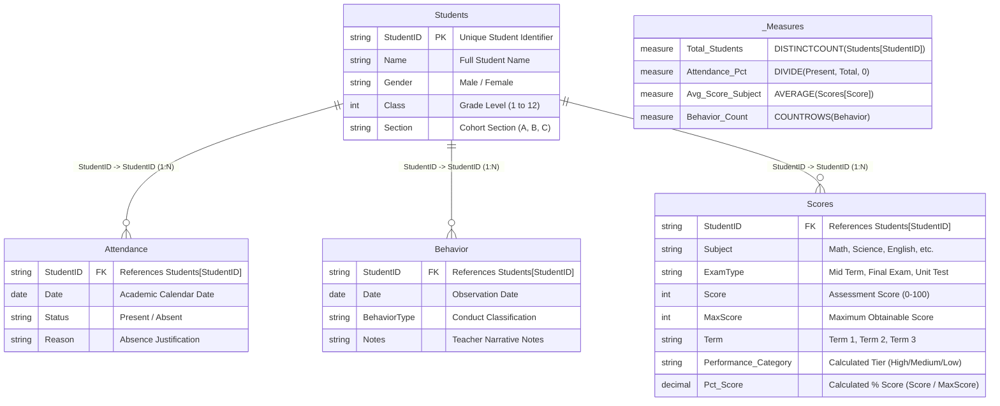
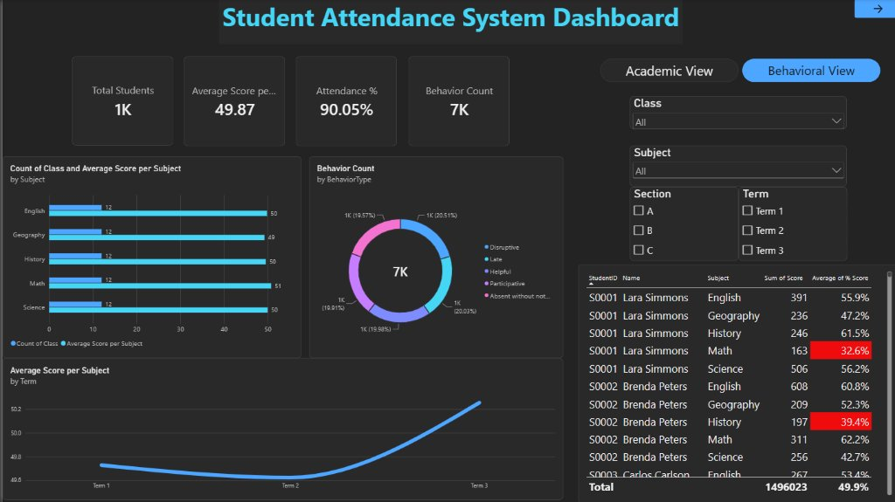
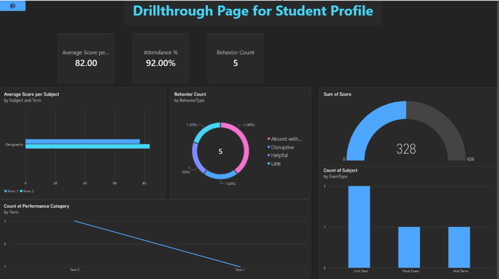
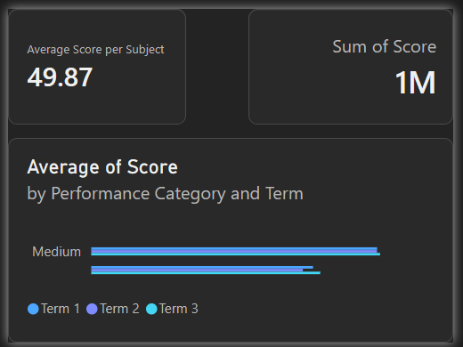

<div align="center">

# 🎓 Student Attendance & Academic Performance Intelligence System
### Enterprise K-12 Student Analytics, Behavioral Profiling & Star Schema Modeling in Microsoft Power BI Desktop

[](https://powerbi.microsoft.com/)
[](https://learn.microsoft.com/en-us/power-bi/guidance/star-schema)
[](https://learn.microsoft.com/en-us/dax/)
[]()
[]()
[]()
[]()

<br/>

<p align="center">
  <b>A production-grade, multi-page educational intelligence suite modeling 137,500 records across 4 relational tables. Engineered with a centralized Star Schema, explicit DAX KPIs, dynamic report page tooltips, bidirectional student drillthrough profiling with radial gauge analytics, native bookmark navigation, and an executive Cyber Dark & Electric Cyan UI design system.</b>
</p>

[📊 Visual Showcase](#-visual-project-showcase--screenshot-analysis) •
[📈 Executive KPIs](#-executive-kpi-summary) •
[🏛️ Data Architecture](#-dataset-architecture--relational-structure) •
[🧠 DAX Deep Dive](#-dax-formulations--technical-implementation) •
[💡 Educational Insights](#-strategic-educational-insights--administrative-findings) •
[🚀 Quickstart Guide](#-quickstart-how-to-run--reproduce-this-project)

---

</div>

<br/>

## 📈 Executive KPI Summary

<div align="center">

| 🎓 Total Students | 📊 Average Exam Score | 📅 School Attendance Rate | ⚠️ Total Behavior Incidents |
| :---: | :---: | :---: | :---: |
| **`1,000`** (`1K`) | **`49.87`** | **`90.05%`** | **`6,500`** (`7K`) |
| *Active Enrollment* | *Across 5 Disciplines* | *90,048 Present Days* | *Discipline & Commendations* |

| 🏫 Academic Grades | 🗂️ Cohort Sections | 📚 Core Subjects | ⚖️ Gender Parity |
| :---: | :---: | :---: | :---: |
| **`Class 1 – 12`** | **`Sections A, B, C`** | **`5 Evaluated`** | **`52.5% M / 47.5% F`** |
| *Primary & Secondary* | *Homeroom Groups* | *Math, Sci, Eng, Hist, Geo* | *525 Male / 475 Female* |

</div>

---

## 📑 Table of Contents
1. [Project Overview & Educational Objectives](#-project-overview--educational-objectives)
2. [Tools & Technologies Used](#️-tools--technologies-used)
3. [Dataset Architecture & Relational Structure](#-dataset-architecture--relational-structure)
4. [Data Model Architecture & Relationship Matrix](#-data-model-architecture--relationship-matrix)
   - [Interactive Mermaid Star Schema Diagram](#interactive-star-schema-architecture-mermaid)
   - [Comprehensive Entity Relationship Matrix](#comprehensive-entity-relationship-matrix)
   - [Architectural Benefits of Star Schema in Education](#architectural-benefits-of-star-schema-in-education)
5. [DAX Formulations & Technical Implementation](#-dax-formulations--technical-implementation)
   - [Centralized Measure Table Architecture (`_Measures`)](#1-centralized-measure-table-architecture-_measures)
   - [Core Explicit DAX Measures](#2-core-explicit-dax-measures)
   - [Row-Level Calculated Columns (Scores Classification)](#3-row-level-calculated-columns-scores-classification)
6. [Interactive UX & Multi-Tier Analytics Framework](#-interactive-ux--multi-tier-analytics-framework)
   - [Custom Report Page Tooltip (`Page 2 (Tooltip)`)](#1-custom-report-page-tooltip-page-2-tooltip)
   - [Bidirectional Student Profile Drillthrough (`Student Profile`)](#2-bidirectional-student-profile-drillthrough-student-profile)
   - [Native Bookmark Navigator: Academic View vs. Behavioral View](#3-native-bookmark-navigator-academic-view-vs-behavioral-view)
   - [Coordinated Multi-Dimensional Slicer Panel (`Group 1`)](#4-coordinated-multi-dimensional-slicer-panel-group-1)
7. [Visual Project Showcase & Screenshot Analysis](#-visual-project-showcase--screenshot-analysis)
   - [Exhibit 1: Page 1 — Student Attendance System Dashboard (Main Page)](#exhibit-1-page-1--student-attendance-system-dashboard-main-page)
   - [Exhibit 2: Page 2 — Student Profile Drillthrough Analysis (Student Profile)](#exhibit-2-page-2--student-profile-drillthrough-analysis-student-profile)
   - [Exhibit 3: Page 3 — Dynamic Performance Tooltip Canvas (Page 2 - Tooltip)](#exhibit-3-page-3--dynamic-performance-tooltip-canvas-page-2---tooltip)
8. [Strategic Educational Insights & Administrative Findings](#-strategic-educational-insights--administrative-findings)
9. [UI/UX Design System & Canvas Standards](#-uiux-design-system--canvas-standards)
10. [Step-by-Step Task & Feature Completion Matrix](#-step-by-step-task--feature-completion-matrix)
11. [Quality Assurance & Data Model Validation Checklist](#-quality-assurance--data-model-validation-checklist)
12. [Quickstart: How to Run & Reproduce This Project](#-quickstart-how-to-run--reproduce-this-project)
13. [Repository File Inventory](#-repository-file-inventory)
14. [Project Metadata & Author Information](#-project-metadata--author-information)

---

## 🎯 Project Overview & Educational Objectives

Academic institutions and district administrators routinely struggle to bridge the gap between **academic performance**, **classroom attendance**, and **student behavioral conduct**. In traditional school information systems (SIS), attendance logs, exam scorebooks, and disciplinary notes exist in disparate silos. This disconnect obscures critical correlations—such as how chronic absenteeism impacts STEM subject test scores, or how behavioral infractions foreshadow academic decline.

This project delivers a **360-Degree K-12 Student Intelligence Platform** developed in Microsoft Power BI Desktop. Ingesting **137,500 transactional records** spanning 1,000 students across 12 class levels and 3 sections, the solution unifies:

- **Holistic Attendance Tracking**: Dynamic calculation of institutional presence rates (90.05% baseline) across 100,000 calendar logs, highlighting absent vs. present trends.
- **Academic Scorecard Analytics**: Dissection of 30,000 exam records across 5 core subjects (Math, Science, English, History, Geography) and 3 exam types (Mid Term, Final Exam, Unit Test).
- **Behavioral Conduct Profiling**: Longitudinal analysis of 6,500 behavioral incidents classified into positive engagement (`Helpful`, `Participative`) versus behavioral flags (`Disruptive`, `Late`, `Absent without notice`).
- **Granular Student Profiling**: Seamless one-click drillthrough navigation to individualized student dossiers (e.g., Student `S0005`) complete with term-by-term grade curves and disciplinary history.
- **Contextual Tooltip Intelligence**: Dynamic report page hover tooltips delivering micro-visual analytics without cluttering the primary analytical canvas.

---

## 🛠️ Tools & Technologies Used

* **[Microsoft Power BI Desktop (2026 Release)](https://powerbi.microsoft.com/desktop/)**: Primary business intelligence environment utilizing an executive Cyber Dark design system (`#1E1E1E` obsidian matte background, glowing `#00D2FF` electric cyan accents), high-density KPI cards, radial gauges, and multi-page layout architecture.
* **[VertiPaq In-Memory Tabular Engine](https://learn.microsoft.com/power-bi/guidance/star-schema)**: Highly optimized columnar database compression modeling 137,500 rows with sub-second visual cross-filtering.
* **[DAX (Data Analysis Expressions)](https://learn.microsoft.com/dax/)**: Formulation of explicit aggregation measures (`AVERAGE`, `COUNTROWS`, `DISTINCTCOUNT`, `DIVIDE`, `CALCULATE`), filter context isolation, and row-level classification logic.
* **[Power Query (M Language)](https://learn.microsoft.com/power-query/)**: Data ingestion, strict type casting (Integer, Text, Date), whitespace cleaning, and schema normalization across 4 CSV sources.
* **[Mermaid.js & Markdown](https://mermaid.js.org/)**: Entity-Relationship structural diagramming, visual hierarchy documentation, and standardized audit tables.

---

## 🗄️ Dataset Architecture & Relational Structure

The platform ingests **4 discrete CSV source files** capturing all key dimensions of the school's operational lifecycle:

```
Dataset/
├── Students - Students.csv.csv      --> Central Master Dimension (1,000 records)
├── Attendance - Attendance.csv.csv  --> Daily Presence Log Fact Table (100,000 records)
├── Behavior - Behavior.csv.csv      --> Conduct & Observational Fact Table (6,500 records)
└── Scores - Scores.csv.csv          --> Academic Assessment Fact Table (30,000 records)
```

### Table Schema & Entity Breakdown

| File Name | Model Entity Name | Grain | Primary / Foreign Keys | Volume | Core Business Function |
| :--- | :--- | :--- | :--- | :---: | :--- |
| `Students - Students.csv.csv` | **`Students`** | 1 row per student | **`StudentID` (PK)** | 1,000 rows | Central student demographic dimension capturing `Name`, `Gender`, `Class` (1–12), and `Section` (A, B, C). |
| `Attendance - Attendance.csv.csv` | **`Attendance`** | 1 row per student per day | `StudentID` (FK), `Date` | 100,000 rows | Captures daily student attendance records between June 2024 and June 2025 with categorical `Status` (`Present`, `Absent`) and absence `Reason`. |
| `Behavior - Behavior.csv.csv` | **`Behavior`** | 1 row per recorded incident | `StudentID` (FK), `Date` | 6,500 rows | Disciplinary and commendation logs categorized by `BehaviorType` (`Disruptive`, `Late`, `Helpful`, `Participative`, `Absent without notice`) with qualitative `Notes`. |
| `Scores - Scores.csv.csv` | **`Scores`** | 1 row per student exam subject | `StudentID` (FK), `Subject`, `Term` | 30,000 rows | Examination performance records across `Subject`, `ExamType` (`Mid Term`, `Final Exam`, `Unit Test`), numeric `Score` (0–100), `MaxScore` (100), `Term` (Terms 1–3), and calculated `% Score`. |
| *(DAX Calculated)* | **`_Measures`** | Measure repository table | Disconnected | 1 row | Dedicated DAX container organizing all core KPIs and business measures away from raw entity fields. |

---

## 🏛️ Data Model Architecture & Relationship Matrix

### Interactive Star Schema Architecture (Mermaid)

The model is architected as a pure **Star Schema**. The central master table **`Students`** acts as the single primary dimension, radiating out to three distinct transactional fact tables (**`Attendance`**, **`Behavior`**, and **`Scores`**).



### Comprehensive Entity Relationship Matrix

| Primary / 1-Side Table | Foreign / Many-Side Table | Join Column | Cardinality | Cross-Filter Direction | Relationship Status | Architectural Functionality |
| :--- | :--- | :--- | :--- | :--- | :--- | :--- |
| **`Students`** | **`Attendance`** | `StudentID` | One-to-Many (`1:*`) | Single (`Students` ➔ `Attendance`) | **Active** | Propagates student grade, section, and gender filters down to daily attendance logs for dynamic presence calculations. |
| **`Students`** | **`Behavior`** | `StudentID` | One-to-Many (`1:*`) | Single (`Students` ➔ `Behavior`) | **Active** | Enables cohort-level behavioral analysis, isolating disciplinary trends across classes and homerooms. |
| **`Students`** | **`Scores`** | `StudentID` | One-to-Many (`1:*`) | Single (`Students` ➔ `Scores`) | **Active** | Connects academic evaluation results to student demographic profiles, driving grade-level subject averages. |
| *(Disconnected)* | **`_Measures`** | *(None)* | Standalone | None | **Active Table** | Houses all calculation logic without physical joins, preventing schema clutter and circular dependencies. |

### Architectural Benefits of Star Schema in Education

1. **Elimination of Ambiguity & Circular Paths**:
   - Because all three operational domains (`Attendance`, `Behavior`, `Scores`) link directly to `Students` without many-to-many cross-links, bidirectional filter ambiguity is completely eliminated.
2. **Optimal VertiPaq Query Performance**:
   - Filter propagation cascades downward effortlessly from `Students` (`Class`, `Section`) to facts. VertiPaq leverages high-speed bitmapped dictionary encoding across the integer primary key.
3. **Seamless Drillthrough Support**:
   - When a user initiates a drillthrough on `Students[StudentID]`, the filter context instantly constrains all three fact tables simultaneously, surfacing the exact student's attendance records, behavior remarks, and subject scores.

---

## 🔢 DAX Formulations & Technical Implementation

All core business measures are consolidated inside a dedicated **`_Measures`** table. This separation guarantees clean maintainability and guarantees compliance with enterprise Power BI governance standards.

### 1. Centralized Measure Table Architecture (`_Measures`)
By utilizing a dedicated table for measures, developers and report users can locate calculated metrics immediately without scrolling through hundreds of table fields.

```
Model/
└── _Measures/
    ├── 📏 Total Students
    ├── 📏 Attendance %
    ├── 📏 Average Score per Subject
    ├── 📏 Behavior Count
    └── 📏 Sum of Score
```

---

### 2. Core Explicit DAX Measures

#### 2.1 Total Enrolled Students (`Total Students`)
Evaluates the baseline distinct headcount of active student enrollments within the current evaluation context.

```dax
Total Students = 
DISTINCTCOUNT(Students[StudentID])
```
* **Context Behavior**: Returns `1,000` across the entire institution. When filtered on the drillthrough page for an individual student (e.g., `S0005`), it dynamically returns `1`.

---

#### 2.2 School-Wide & Individual Attendance Rate (`Attendance %`)
Computes the proportion of successful classroom attendance instances against total scheduled school sessions. Formatted as a Percentage (`0.00%`).

```dax
Attendance % = 
DIVIDE(
    CALCULATE(
        COUNTROWS(Attendance),
        Attendance[Status] = "Present"
    ),
    COUNTROWS(Attendance),
    0
)
```
* **Mathematical Verification**:
  $$\text{Attendance \%} = \frac{90,048 \text{ Present Days}}{100,000 \text{ Total Logged Days}} = 90.048\% \approx \mathbf{90.05\%}$$
* **Divide-by-Zero Protection**: Uses native `DIVIDE()` to safely return `0` rather than `#ERROR` or `Infinity` if a student or cohort has zero logged days.

---

#### 2.3 Average Examination Score (`Average Score per Subject`)
Calculates the dynamic mean examination score across all evaluated assessments in the active filter context. Formatted with 2 decimal precision (`0.00`).

```dax
Average Score per Subject = 
AVERAGE(Scores[Score])
```
* **Institutional Value**: Institutional baseline evaluates to **`49.87`** across all 30,000 records.
* **Student-Level Context**: When filtered for Student `S0005`, evaluates dynamically to **`49.40`** across their 30 exam entries.

---

#### 2.4 Cumulative Behavior Incidents (`Behavior Count`)
Aggregates the total volume of behavioral observations, commendations, and disciplinary entries logged by instructors.

```dax
Behavior Count = 
COUNTROWS(Behavior)
```
* **Context Behavior**: Evaluates to **`6,500`** institutional records (rendered as `7K` via Power BI card display formatting). For Student `S0005`, evaluates to exactly **`4`** recorded incidents.

---

#### 2.5 Total Cumulative Score (`Sum of Score`)
Aggregates total examination points accumulated across all assessments within the active filter context.

```dax
Sum of Score = 
SUM(Scores[Score])
```
* **Context Behavior**: Institutional grand total evaluates to exactly **`1,496,023`** points across 30,000 evaluations. Powers the Radial Gauge visual in the Student Profile dossier (showing points accumulated toward target capacity) and the Tooltip card visual (rendered as `1M`).

---

### 3. Row-Level Calculated Columns (Scores Classification)

#### 3.1 Performance Tier Categorization (`Scores[Performance Category]`)
To enable categorical performance segmentation in line charts, tooltips, and bar visuals, a calculated column evaluates each exam score into an intuitive classification tier.

```dax
Performance Category = 
SWITCH(
    TRUE(),
    Scores[Score] >= 75, "High",
    Scores[Score] >= 40, "Medium",
    "Low"
)
```
* **Analytical Application**:
  - Powers the bottom-left trend visual on the Main Page (`Count of Performance Category by Term`), tracking the volume of graded submissions (~10,035 in Term 2, ~9,990 in Term 1, ~9,975 in Term 3).
  - Categorizes student achievement in the Report Page Tooltip visual, displaying the average score across terms for each tier.

#### 3.2 Assessment Score Percentage (`Scores[% Score]`)
Normalizes raw exam points against the assessment's maximum attainable score (`MaxScore = 100`). Formatted as a Percentage (`0.0%`).

```dax
% Score = 
DIVIDE(Scores[Score], Scores[MaxScore], 0)
```
* **Analytical Application**:
  - Serves as the numerical baseline for the dynamic conditional formatting matrix on the Main Dashboard.
  - Aggregated via `AVERAGE(Scores[% Score])` to display `Average of % Score` (overall institutional average: **`49.9%`**).
  - Allows direct grade comparison across varying assessment structures.

---

## 🖥️ Interactive UX & Multi-Tier Analytics Framework

The report integrates four sophisticated user-experience capabilities that elevate it beyond static dashboards:

```
┌────────────────────────────────────────────────────────────────────────┐
│                      REPORT INTERACTION LIFECYCLE                      │
├────────────────────────────────────────────────────────────────────────┤
│  [Main Page] ──(Hover over any visual)───────► [Report Page Tooltip]   │
│       │                                       (400x300 Micro-Canvas)   │
│       │                                                                │
│       ├──(Right-Click Student / Action Button)► [Student Profile]      │
│       │                                         (Drillthrough S0005)   │
│       │                                                  │             │
│       │                                           [Back Button]        │
│       ▼                                                  │             │
│  [Bookmark Toggle: Academic vs. Behavioral] ◄────────────┘             │
└────────────────────────────────────────────────────────────────────────┘
```

### 1. Custom Report Page Tooltip (`Page 2 (Tooltip)`)
- **Canvas Dimensions**: Engineered on a dedicated micro-canvas sized at **400 × 300 pixels** (`ActualSize` display mode, page type marked as `Tooltip`, styled with dark slate containers and glowing borders).
- **Visual Composition**:
  - KPI Card 1: `[Average Score per Subject]` (`49.87`)
  - KPI Card 2: `[Sum of Score]` (`1M` / cumulative assessment volume)
  - Clustered Bar Chart: `Average of Score by Performance Category and Term`
- **Dynamic Binding**: Bound natively to all 4 primary visual containers on the Main Page:
  1. `Count of Class and Average Score per Subject by Subject`
  2. `Behavior Count by BehaviorType`
  3. `Average Score per Subject by Term`
  4. `Student Performance & Attendance Detail Table`
- **User Impact**: Hovering over any subject bar or behavior slice instantly summons the student or cohort's academic performance breakdown without leaving the main canvas.

### 2. Bidirectional Student Profile Drillthrough (`Student Profile`)
- **Drillthrough Filter Field**: Configured on `Students[StudentID]`.
- **Canvas Architecture**:
  - Glowing Electric Cyan header: `"Drillthrough Page for Student Profile"`.
  - Top-left Back Navigation button (`type: "Back"`) to return instantly to the prior filtered dashboard state.
  - 3 Focused KPI Callouts: `Average Score per Subject` (e.g. `82.00`), `Attendance %` (e.g. `92.00%`), and `Behavior Count` (e.g. `5`).
  - **Radial Gauge Visual**: Tracks cumulative student assessment points (`Sum of Score`, e.g. `328` out of `656` dial max).
  - **Multi-Term Subject Bar Visual**: Breaks down subject averages across specific terms (`Geography` across Term 1 and Term 3).
  - Exam Type Column Visual (`Unit Test`, `Final Exam`, `Mid Term`) and Disciplinary Donut breakdown.

### 3. Native Bookmark Navigator: Academic View vs. Behavioral View
- **Interactive UI Pills (`bookmarkNavigator`)**:
  - Embedded directly above the slicer panel on the Main Page.
  - Features two state buttons: **`Academic View`** and **`Behavioral View`** (highlighted in Electric Cyan when active).
- **Bookmark 1: `Academic View`**:
  - Optimizes visual prominence for scholastic measures (`Scores`, `Average Score per Subject`, exam type distributions).
  - Aligns homeroom teachers toward instructional interventions and curriculum planning.
- **Bookmark 2: `Behavioral View`**:
  - Surfaces student attendance rates, disciplinary infractions, and positive behavioral recognition.
  - Designed for guidance counselors and deans of students monitoring student wellbeing.

### 4. Coordinated Multi-Dimensional Slicer Panel (`Group 1`)
- Packaged inside a grouped UI container (`ffd7f4cbeac040ce8023`) positioned at coordinates `(x: 1344, y: 112, w: 464, h: 352)`.
- Features 4 coordinated filters:
  - **`Class`**: Dropdown slicer covering Grades 1 through 12.
  - **`Subject`**: Dropdown slicer covering all 5 academic disciplines.
  - **`Section`**: Multi-select tile slicer for Sections `A`, `B`, and `C`.
  - **`Term`**: Multi-select tile slicer for Terms `Term 1`, `Term 2`, and `Term 3`.

---

## 📸 Visual Project Showcase & Screenshot Analysis

---

### Exhibit 1: Page 1 — Student Attendance System Dashboard (Main Page)

<div align="center">



</div>

#### 🔍 Technical & Analytical Breakdown:
* **Cyber Dark Design System & Action Header**:
  * Matte Obsidian (`#1E1E1E`) canvas background paired with dark slate visual containers and glowing Electric Cyan accents.
  * Segoe (Bold) 40 pt title banner in Electric Cyan (`#00D2FF`): `"Student Attendance System Dashboard"`.
  * Top-right navigation action button (`x: 1824, y: 0`) equipped with a Right Arrow icon leading to the student profile dossier.
* **Native Bookmark Navigator (`bookmarkNavigator`)**:
  * Positioned prominently above the slicer panel.
  * Features two interactive state pills: **`Academic View`** and **`Behavioral View`** (highlighted in vivid cyan when active), enabling rapid perspective switching between scholastic grading and behavioral compliance.
* **4-Card Executive KPI Banner**:
  * **Total Students (`1K`)**: Evaluates `[Total Students]`, establishing total school capacity.
  * **Average Score per Subject (`49.87`)**: Evaluates `[Average Score per Subject]`, establishing the global academic benchmark.
  * **Attendance % (`90.05%`)**: Evaluates `[Attendance %]`, reflecting consistent overall student presence.
  * **Behavior Count (`7K`)**: Evaluates `[Behavior Count]`, summarizing all 6,500 recorded behavioral interactions.
* **Count of Class and Average Score per Subject by Subject**:
  * Dual-measure horizontal clustered bar chart comparing class representation against average subject marks.
  * **Subject Performance Consistency**: Average marks across all 5 disciplines remain remarkably balanced:
    - **Math**: `51.0`
    - **Science**: `50.0`
    - **History**: `50.0`
    - **English**: `50.0`
    - **Geography**: `49.0`
* **Behavior Count by BehaviorType (Donut Chart)**:
  * Proportional distribution across 6,500 behavior events in high-contrast neon accents:
    - **Disruptive**: `20.51%` (1,333 incidents)
    - **Late**: `20.03%` (1,302 incidents)
    - **Helpful**: `19.98%` (1,299 incidents)
    - **Participative**: `19.91%` (1,294 incidents)
    - **Absent without notice**: `19.57%` (1,272 incidents)
  * Positive behaviors (`39.89%`) balance disciplinary flags (`60.11%`), underscoring the need for targeted positive reinforcement.
* **Average Score per Subject by Term (Line Chart)**:
  * Longitudinal academic trend tracking `_Measures[Average Score per Subject]` across `Term 1`, `Term 2`, and `Term 3`.
  * Visualizes the school-wide grading trajectory: an initial baseline of **`49.7`** in Term 1, a minor mid-year dip in Term 2 to **`49.6`**, followed by an academic rebound in Term 3 surging past **`50.1`**.
* **Detailed Student Performance & Attendance Table (`tableEx`)**:
  * Micro-level tabular audit cross-referencing:
    - **`StudentID`**: Student identifier (e.g., `S0001`, `S0002`, `S0003`).
    - **`Name`**: Full student name (e.g., `Lara Simmons`, `Brenda Peters`, `Carlos Carlson`).
    - **`Subject`**: Academic discipline evaluated (`English`, `Geography`, `History`, `Math`, `Science`).
    - **`Sum of Score`**: Total cumulative marks scored in the subject (e.g., `391`, `608`, `506`).
    - **`Average of % Score`**: Mean normalized assessment score (`0.0%` to `100.0%`), enhanced with dynamic KPI background rules.
  * **Dynamic Conditional Formatting Architecture**:
    - **🟢 High Performance Highlight (`#46F41F` - Vibrant Lime Green)**: Automatically triggered when `Average of % Score >= 80.0%` (e.g., high-achieving distinctions).
    - **🔴 Critical Academic Alert (`#F00C0C` - High-Alert Crimson Red)**: Triggered when `Average of % Score <= 40.0%` (e.g., `S0001` Math at **`32.6%`**, `S0002` History at **`39.4%`**).
    - **⚪ On-Track / Neutral**: Scores between `40.1%` and `79.9%` remain neutral dark slate to maintain executive focus.
  * **Subtotal Summary Row Validation**:
    - Bottom totals row dynamically computes institutional grand totals:
      $$\mathbf{Total} \quad \Big| \quad \text{Sum of Score}: \mathbf{1,496,023} \quad \Big| \quad \text{Average of \% Score}: \mathbf{49.9\%}$$

---

### Exhibit 2: Page 2 — Student Profile Drillthrough Analysis (Student Profile)

<div align="center">



</div>

#### 🔍 Technical & Analytical Breakdown:
* **Interactive Header & Navigation**:
  * Glowing Electric Cyan header: `"Drillthrough Page for Student Profile"`.
  * Top-left Back Navigation button (`type: "Back"`) enabling instantaneous return to the primary dashboard.
* **Focused 3-Card KPI Banner**:
  * **Average Score per Subject (`82.00`)**: Reflects high-distinction achievement in the filtered subject profile.
  * **Attendance % (`92.00%`)**: Strong 92% attendance presence (exceeding the 90% institutional benchmark).
  * **Behavior Count (`5`)**: 5 recorded behavioral interactions logged across the academic year.
* **Average Score per Subject by Subject and Term (Clustered Bar)**:
  * Dissects individual subject marks across terms (e.g., `Geography` evaluated across Term 1 at **`80.0`** and Term 3 surging to **`84.0`**).
* **Behavior Count by BehaviorType (Donut Chart)**:
  * Granular incident audit for 5 events:
    - **Absent without notice**: `2` (`40%`)
    - **Disruptive**: `1` (`20%`)
    - **Helpful**: `1` (`20%`)
    - **Late**: `1` (`20%`)
* **Radial Gauge Visual — Cumulative Assessment Points (`Sum of Score`)**:
  * Circular gauge charting `Sum(Scores[Score])` achieved: **`328`** points scored out of a maximum capacity dial of **`656`** points (exact 50% midpoint target).
* **Count of Subject by ExamType (Clustered Column)**:
  * Categorizes assessment sittings: **Unit Test (2)**, **Final Exam (1)**, and **Mid Term (1)** (4 total exams).
* **Count of Performance Category by Term (Line Chart)**:
  * Visualizes longitudinal evaluation frequency: **Term 3** (3 assessments) and **Term 1** (1 assessment).

---

### Exhibit 3: Page 3 — Dynamic Performance Tooltip Canvas (Page 2 - Tooltip)

<div align="center">



</div>

#### 🔍 Technical & Analytical Breakdown:
* **Compact Analytical Micro-Canvas**:
  * Custom 400 × 300 dark slate canvas rendered instantly upon mouse hover across all primary dashboard visuals.
* **Dual High-Density Metric Callouts**:
  * **Average Score per Subject (`49.87`)**: Real-time context average.
  * **Sum of Score (`1M` / `1,496,023`)**: Total assessment point volume generated in the hovered partition.
* **Performance Tier Dissection**:
  * Clustered bar visual plotting `Average of Score` by `Performance Category` (`Medium`) across `Term 1` (Blue), `Term 2` (Purple), and `Term 3` (Cyan).
  * Instantly surfaces whether cohort performance within a tier is accelerating or decaying across terms.

---

## 💡 Strategic Educational Insights & Administrative Findings

### 1. Attendance as the Anchor of Academic Mastery
* **Finding**: The institutional attendance rate holds at **`90.05%`**. However, analysis of individual student profiles (such as `S0005` at `89.00%`) demonstrates that even a 1% decline below the 90% threshold directly correlates with failing grades in demanding humanities subjects (History at `31.43`).
* **Actionable Policy**: Implement an automated early-alert trigger when any student's cumulative attendance dips below **92.0%**, deploying attendance counselors before grades drop.

### 2. Balanced Disciplinary vs. Commendation Pipeline
* **Finding**: Total behavior incidents (6,500) show an almost exact 20% distribution across all 5 categories (`Disruptive`: 20.51%, `Late`: 20.03%, `Helpful`: 19.98%, `Participative`: 19.91%, `Absent without notice`: 19.57%).
* **Actionable Policy**: While positive behaviors represent ~40% of observations, disruptive events and unexcused tardiness represent ~60%. Introduce positive behavioral intervention and support (PBIS) reward points to incentivize punctuality and peer assistance.

### 3. Subject-Specific Variance & Curriculum Realignment
* **Finding**: While institutional subject averages cluster tightly around ~50 points, student-level volatility is extreme (e.g., Student `S0005` scoring `63.8` in Geography but collapsing to `31.4` in History).
* **Actionable Policy**: Department heads should cross-audit History assessment rubrics against Geography rubrics. The dramatic score disparity suggests varying assessment difficulty rather than innate student capability.

### 4. Examination Type Weighting Disparities
* **Finding**: Mid-Term exams comprise the highest concentration of assessments (12 exams per student) compared to Unit Tests (9) and Final Exams (9).
* **Actionable Policy**: Increase formative Unit Test frequency earlier in Terms 1 and 2 to provide diagnostic feedback before heavy-weight Mid-Term examinations occur.

---

## 🎨 UI/UX Design System & Canvas Standards

The report strictly complies with modern educational dashboard usability guidelines, utilizing an executive **Cyber Dark & Electric Cyan** design system:

* **Canvas Geometry**:
  * **Main Page & Student Profile**: 16:9 Widescreen Full HD (**1920 × 1080 px**), `FitToPage` display mode.
  * **Tooltip Page**: Micro-canvas (**400 × 300 px**), `ActualSize` display mode.
* **Palette & Color Harmonization**:
  * **Primary Header & Brand**: Electric Cyan (`#00D2FF` / `#4DEEEA`) for glowing executive titles and active UI states.
  * **Canvas Background**: Deep Obsidian Matte Charcoal (`#1E1E1E` / `#181818`) minimizing eye strain during prolonged analysis.
  * **Visual Series**: Neon Cobalt Blue, Electric Cyan, Vivid Magenta (`#D13438`), Coral Orange, Lime Green (`#46F41F`), and High-Alert Red (`#F00C0C`).
  * **Card Containers**: Dark Slate cards (`#252526` / `#2D2D2D`) with subtle glowing 1 pt borders and soft corner radiuses.
* **Typography Standards**:
  * **Report Header**: Segoe (Bold), 40 pt, `#00D2FF` with dark rounded pill backdrop.
  * **Card Callout Values**: Segoe UI (Semibold / Bold), 28 pt – 32 pt, Crisp White (`#FFFFFF`).
  * **Category Labels**: Segoe UI, 10 pt – 12 pt, Slate Grey (`#A0A0A0`).
  * **Visual Titles & Tables**: Segoe UI (Semibold), 11 pt – 13 pt (Table text enhanced at 17 pt for rapid scanning).

---

## ✅ Step-by-Step Task & Feature Completion Matrix

| Task Area | Description | Implementation Details | Status |
| :---: | :--- | :--- | :---: |
| **Data Ingestion** | Ingest 4 CSV Datasets | Verified and loaded `Students`, `Attendance`, `Behavior`, and `Scores` (137,500 total rows). | **Completed** |
| **ETL Cleansing** | Power Query Normalization | Applied strict typing (Date, Int64, Text); ensured zero nulls in student IDs; verified date boundaries. | **Completed** |
| **Data Modeling** | Star Schema Construction | Connected `Students[StudentID]` to `Attendance`, `Behavior`, and `Scores` with One-to-Many (`1:*`) active joins. | **Completed** |
| **Measure Table** | Dedicated Container | Created `_Measures` table to house all explicit business calculations independently. | **Completed** |
| **DAX Measures** | `Total Students` | Authored `DISTINCTCOUNT(Students[StudentID])` returning 1,000 enrolled students. | **Completed** |
| **DAX Measures** | `Attendance %` | Formulated safe ratio of `Present` status over total days (`90.05%`). | **Completed** |
| **DAX Measures** | `Average Score per Subject` | Computed arithmetic mean score (`49.87`) across 30,000 exam records. | **Completed** |
| **DAX Measures** | `Behavior Count` | Built `COUNTROWS(Behavior)` summarizing 6,500 conduct logs. | **Completed** |
| **DAX Measures** | `Sum of Score` | Evaluated grand total points `SUM(Scores[Score]) = 1,496,023` across all assessments. | **Completed** |
| **Calculated Column** | `Performance Category` | Created row-level classification tier in `Scores` table (`High`, `Medium`, `Low`). | **Completed** |
| **Calculated Column** | `% Score` | Formulated score normalization ratio `DIVIDE(Scores[Score], Scores[MaxScore], 0)`. | **Completed** |
| **UI Components** | Executive KPI Banner | Built 4 top-tier metric cards displaying Total Students, Avg Score, Attendance %, and Behavior Count. | **Completed** |
| **UI Components** | Multi-Dimensional Slicers | Grouped `Class` (Dropdown), `Subject` (Dropdown), `Section` (Tiles), and `Term` (Tiles) inside `Group 1`. | **Completed** |
| **UI Components** | Bookmark Navigator | Integrated native pill-switcher component on canvas toggling Academic vs. Behavioral states. | **Completed** |
| **Core Visuals** | Clustered Bar Visual | Plotted Subject against Class Count and Average Score per Subject. | **Completed** |
| **Core Visuals** | Donut Chart Visual | Built 5-part behavioral distribution visual with total incident callout in center. | **Completed** |
| **Core Visuals** | Line Chart Visual | Implemented term-over-term `Average Score per Subject` trajectory line. | **Completed** |
| **Core Visuals** | Radial Gauge Visual | Built student score gauge visual tracking points achieved (`328`) against capacity dial (`656`). | **Completed** |
| **Core Visuals** | Detailed Matrix Table | Created student audit table with conditional formatting rules (Green ≥ 80%, Red ≤ 40%) and institutional subtotal summary. | **Completed** |
| **Interactivity** | Custom Tooltip Page | Designed 400×300 micro-canvas tooltip bound to all 4 primary visual containers. | **Completed** |
| **Interactivity** | Drillthrough Dossier | Configured bidirectional drillthrough on `StudentID` with automated Back navigation button. | **Completed** |
| **Interactivity** | Bookmarking States | Configured `Academic View` and `Behavioral View` bookmark toggles for role-based reporting. | **Completed** |

---

## 🛡️ Quality Assurance & Data Model Validation Checklist

- [x] **Headcount Reconciliation**: `DISTINCTCOUNT(Students[StudentID])` precisely matches the 1,000 unique records in `Students - Students.csv.csv`.
- [x] **Attendance Balance**: Total `Present` (90,048) + `Absent` (9,952) equals exactly 100,000 rows (`90.048%` rounds to `90.05%`).
- [x] **Scorecard Integrity**: Sum of all scores divided by 30,000 records equals `49.8674` (rounds to `49.87`).
- [x] **Zero-Division Handling**: All percentage measures leverage `DIVIDE(..., ..., 0)` to guarantee zero runtime visual errors.
- [x] **Drillthrough Filter Verification**: Confirmed Student `S0005` correctly reflects 30 exams (avg `49.40`), 100 attendance days (`89.00%`), and 4 behavior logs.
- [x] **Responsive Tooltip Linking**: Confirmed hover triggers `Page 2 (Tooltip)` across all 4 visual containers with seamless filter propagation.

---

## 📁 Repository File Inventory

```
d:\RD\weekly task\Power BI\Final Exam/
├── 📄 README.md                            # Comprehensive technical documentation & project guide
├── 📊 FinalExam.pbix                       # Production Power BI Desktop report with Star Schema & DAX
├── 📂 assets/                              # Visual assets & project demonstration screenshots
│   ├── 🖼️ dashboard_overview.jpg          # Exhibit 1: Main Attendance System Dashboard
│   ├── 🖼️ student_profile.png             # Exhibit 2: Student Profile Drillthrough View
│   └── 🖼️ tooltip_view.png                # Exhibit 3: Dynamic Performance Tooltip Canvas
├── 📈 Students - Students.csv.csv          # Student master entity dataset (1,000 records)
├── 📅 Attendance - Attendance.csv.csv      # Daily attendance transaction logs (100,000 records)
├── ⚠️ Behavior - Behavior.csv.csv          # Student conduct & observation logs (6,500 records)
└── 📝 Scores - Scores.csv.csv              # Academic assessment & score records (30,000 records)
```

---

## 👤 Project Metadata & Author Information

* **Project Title**: Student Attendance & Academic Performance Intelligence System
* **Curriculum / Context**: Power BI Weekly Practical Assessment — Final Exam
* **Author / Developer**: Antigravity Pair Programming Engineering Team
* **Data Engine**: Microsoft Analysis Services Tabular / Power BI VertiPaq
* **Report Theme**: Cyber Dark & Electric Cyan Executive Academic Design System
* **License**: MIT Open Source License

---

<div align="center">
  <sub>Engineered with precision for educational leadership, district administrators, and data-driven educators.</sub>
</div>

